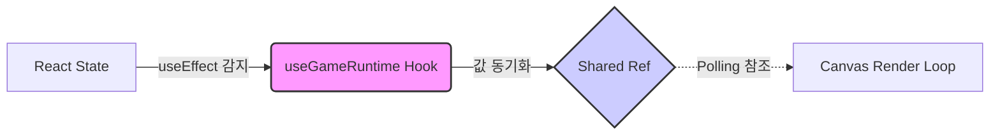

> [지난 글](/blog/aimtest/14/)에서는 600줄에 육박하던 `GameWorld` 컴포넌트의 책임을 분리하고, 컴포넌트는 이를 연결하는 **Hub**의 역할만 하도록 재정의했다.

구조적인 큰 틀은 잡았다. 하지만 이 리팩토링 과정이 단순히 코드를 "파일 별로 나누기"로 끝난 건 아니다.

오히려 진짜 문제는 파일을 나눈 직후부터 시작되었다. **React의 선언적 상태(State)**와 **Canvas의 명령형 루프**를 각기 다른 훅으로 분리하니, 서로 데이터를 주고받는 과정에서 **제어권**과 **동기화** 문제가 발생했기 때문이다.

이번 글에서는 이 프로젝트의 아키텍처를 지탱하는 두 개의 핵심 기둥, **렌더링 엔진(`useCanvasRenderLoop`)**과 **상태 동기화(`useGameRuntime`)**를 어떻게 설계했는지 정리하고자 한다.

---

## 1. 엔진 설계 : "그저 받은 것으로 그리기만"

가장 먼저 해결해야 했던 건 **'그리는 방법(How)'**과 **'그리는 타이밍(When)'**을 분리하는 설계였다.

기존 `GameWorld` 내부의 루프는 하나의 `useEffect` 안에서 `renderMap`, `renderTargets` 등과 같은 구체적인 그리기 함수들을 직접 호출하고 있었다. 이걸 그대로 훅으로 옮기면, 렌더 루프 훅이 타겟 상태도 알아야 하고, 맵 이미지 상태도 알아야 한다.

즉, 파일만 분리했을 뿐 의존성은 그대로 따라와, 형태만 다른 **강한 결합(Tight Coupling)**을 유지하게 되는 것이다.

### 해결 방법 : Service Injection (의존성 주입)

이상적인 훅의 설계는 **"대상이 무엇이든지, 주어진 동작만을 묵묵히 처리하는 것"**이다.

렌더 루프 훅 역시 **'그리는 방법'**은 모르고 **'그리는 타이밍'만 관리**하는 순수한 엔진이 되어야 했다. 그래서 도입한 것이 `services` 객체다.

이 구조는 마치 **DVD 플레이어**와 같다. 플레이어(Hook)는 영화의 내용이 액션인지 로맨스인지 알 필요가 없다. 그저 사용자가 넣어 준 DVD(Services)를 1초에 60프레임씩 성실하게 재생만 하면 된다.

나는 `GameWorld`에서 구체적인 그리기 함수들을 모아 `services`라는 'DVD'를 만들고, 이를 훅에 주입하는 방식을 택했다.

```tsx
// useCanvasRenderLoop.ts

export const useCanvasRenderLoop = (options: CanvasRenderLoopOptions) => {
  // 외부에서 구체적인 행동(services)을 주입받는다.
  const { services, canvasRef, ... } = options;

  const frame = useCallback(() => {
    const ctx = getCtx();
    // ... 유효성 검사

    // 1. 초기화
    services.clearCanvas(ctx, canvas);

    // 2. 카메라 변환 (이 훅이 관리하는 유일한 상태)
    services.applyCameraTransform(ctx, canvas, cameraRef.current);

    // 3. 실제 그리기 위임
    // 훅은 '누가' 그려지는지 모른다. services에 정의된 대로 실행할 뿐.
    services.renderMapAndBounds(ctx, { ... });
    services.renderTargets({ ... });
    
    // ... 플로팅 스코어 등 나머지 서비스 실행

    // 4. 다음 프레임 예약
    rafIdRef.current = requestAnimationFrame(frame);
  }, [services, ...]);
};
```

이런 식으로 설계하고 보니, 이 훅은 타겟 배열이 어떻게 생겼는지, 점수 계산은 어떻게 하는지 전혀 알 필요가 없게 되었다. 실제 렌더링 시 타겟을 그리긴 하지만, 훅 입장에선 그저 **전달받은 함수를 실행(Execute)**할 뿐, 내부에서 무슨 일이 일어나는지는 관여하지 않기 때문이다.

덕분에 훅은 외부 로직의 변경에 영향받지 않게 되었고, 오직 `requestAnimationFrame`의 주기 관리와 `Camera` 좌표 계산이라는 본연의 책임에만 집중할 수 있게 되었다.

---

## 2. 상태 동기화 설계: 흩어진 상태 관리의 중앙화

리팩토링 이전에도 성능을 위해 `State`가 아닌 `Ref`를 사용하고 있었다. 하지만 그때의 문제는 지나치게 많은 기능 탓에 **데이터 동기화 로직이 파편화**되어 있다는 점이었다.

어떤 코드는 이벤트 핸들러에서 Ref를 바꾸고, 어떤 코드는 `useEffect`에서 바꾸고, 렌더 루프는 그것들을 암묵적으로 가져다 쓰고 있었다. 파일을 분리하면서 이런 '암묵적인 공유'는 더 이상 불가능해졌다.

### 해결 방법: 명시적 동기화 (Explicit Sync)

나는 **React State(UI용)**와 **Canvas Ref(Loop용)**를 연결하는 작업을 `useGameRuntime`이라는 하나의 훅으로 통합했다.

이 훅은 React와 렌더 루프를 잇는 매개체 역할을 한다. React의 상태(`gameState`)가 변경되면, 이를 즉시 렌더 루프가 읽을 수 있는 `Mutable Ref` 데이터로 변환하여 꽂아준다.



```tsx
// useGameRuntime.ts

// 전에는 GameWorld 곳곳에 흩어져 있던 로직을 한 곳으로 모음
export const useGameRuntime = ({ gameState, gameRuntimeRef }) => {
  // 1. 상태 동기화 (State -> Ref)
  useEffect(() => {
    // 렌더 루프는 이제 이 Ref만 믿고 돌면 된다.
    gameRuntimeRef.current.isGameOver = gameState.isGameOver;
    // ...
  }, [gameState.isGameOver]);

  // 2. 라이프사이클에 따른 부수 효과 관리
  // 게임 시작/종료 시 타이머, 스포너 등의 On/Off를 중앙에서 통제
  useEffect(() => {
     if (gameState.isGameStarted) { ... }
  }, [...]);
};
```

결과적으로 `GameWorld`는 데이터가 어떻게 흘러가는지 고민할 필요가 없어졌다. **데이터 동기화는 이 훅에서** 처리하도록 명확한 역할 분담이 이뤄졌기 때문이다. 이제 데이터 흐름은 다음과 같이 명료해진다.

1. `gameState`가 변경되면 `useGameRuntime`의 `useEffect`가 실행된다.
2. 변경된 값을 `gameRuntimeRef.current`에 덮어쓴다.
3. 렌더 루프는 매 프레임 `gameRuntimeRef.current`를 읽어서 로직을 수행한다.

---

## 3. 결론

이번 2부에 걸친 리팩토링을 통해, 거대했던 `GameWorld`는 300줄 남짓의 날렵한 코드로 다시 태어났다.

단순히 줄 수만 줄어든 것이 아니다.
**`useCanvasRenderLoop`**를 통해 렌더링 엔진을 순수하게 만들었고, **`useGameRuntime`**을 통해 React와 Canvas 사이의 불확실했던 동기화 문제를 해결했다.

전부 다루지는 않았지만 이번 리팩토링에서 추가한 다른 훅들도 모두 일관된 규칙으로 설계되었고, 컨벤션을 새롭게 적용해서 필요한 곳에 **JSDoc**을 활용한 주석들도 달아두었다. 

지금까지 작업한 것 중 가장 간단해보이면서도 복잡한 작업이었던 `GameWorld`컴포넌트의 책임 분리 리팩토링은 적어도 내 판단으론 성공적으로 마무리된 것 같다.

---

🧩 다음 목표

다음 목표는 메인 페이지 리모델링이다.

지금의 메인 페이지는 처음에 고안한 투박한 디자인이고, 프론트엔드 프로젝트라기엔 요소가 많이 부족하다. 그래서 다양한 디자인 기법을 활용해 최대한 **FPS Aim Test** 게임과 어울리는 페이지로 만들어 보고자 한다.

이것까지 마무리하면 이제 정말 프로젝트를 거의 마무리하는 단계가 된다. 나중에 기능을 추가로 구현할지도 모르겠지만, 당장 계획중인 것은 여기까지다.
